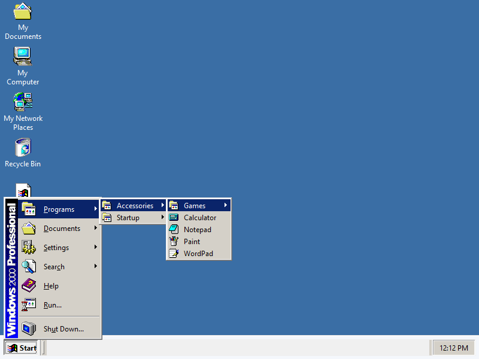
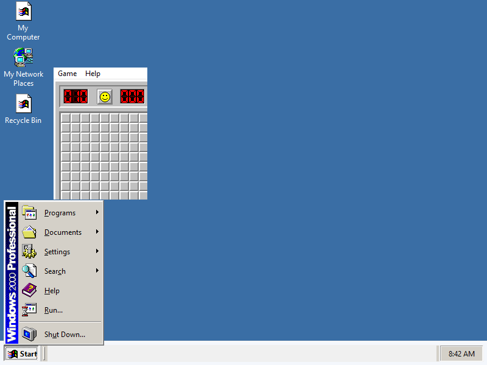
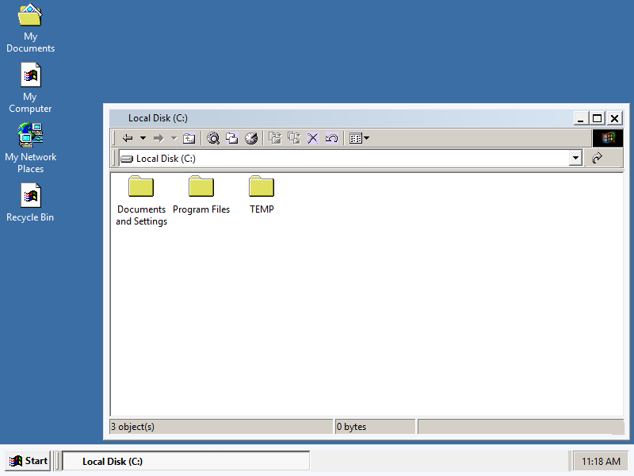
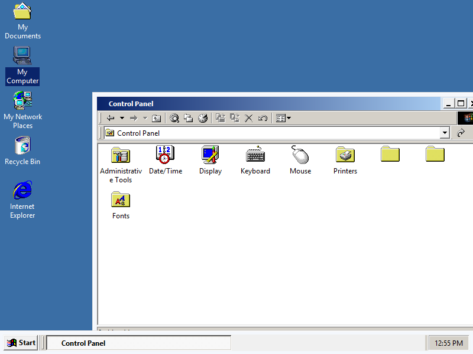
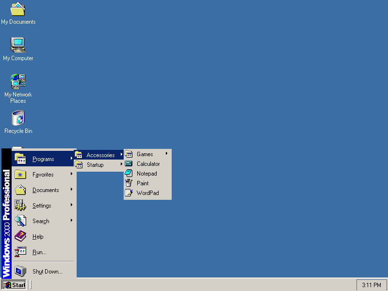
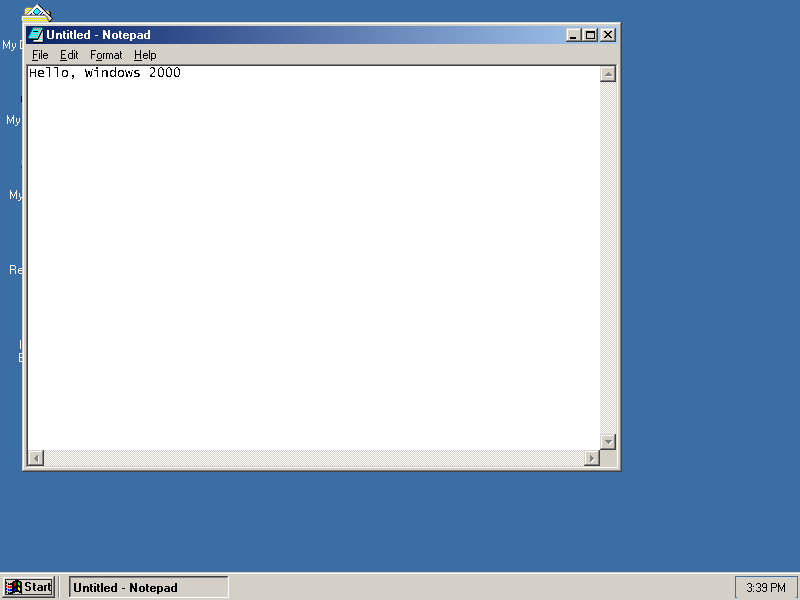

# win2000-recomp

Windows 2000's own userland, statically recompiled with
[pcrecomp](https://github.com/sp00nznet/pcrecomp) and run on a modern
Windows host, with no emulator.

**This repository contains no Windows code or data.** Each user lifts
their own copy of Windows 2000; everything that comes from it (the extracted
files, catalogs and lifted C) goes into the gitignored `work/` and `src/gen/`.



| | |
|---|---|
|  |  |
| Explorer's Start menu (Win11 host) | Start → Run → Minesweeper |
|  |  |
| My Computer → C: (the sandbox root) | Control Panel |
|  |  |
| The same explorer on Linux (X11, no Wine) | Notepad launched from the Linux Start menu |

How it works: [docs/architecture.md](docs/architecture.md).

## Getting Started

You need **your own Windows 2000 CD**: an image (`.iso`) of Windows 2000
Professional with Service Pack 4, or the CD itself. Nothing from Windows is in
this repository or downloaded for you; everything is extracted, lifted and
built on your machine from your copy.

1. Download this repository (the green **Code** button, then **Download ZIP**)
   and unzip it, or `git clone` it, into a folder with no spaces in its path
   and about 25 GB free.
2. Windows: double-click **`Setup.cmd`** and give it your CD image when it
   asks (or `Setup.cmd -Iso D:\iso\win2000.iso`; a drive letter or a
   folder holding `I386` works too).
3. Double-click **`Windows 2000 (recomp).cmd`** in that folder: Windows 2000's
   own explorer starts in an 800x600 window of its own, with its desktop,
   taskbar and Start menu, and the accessories, Control Panel and cmd behind it.

The setup asks before installing anything it needs (Python 3, pefile and
capstone, Git for Windows, 7-Zip, Visual Studio's C++ Build Tools, CMake,
Ninja, and the [pcrecomp](https://github.com/sp00nznet/pcrecomp) toolkit
beside this folder, or wherever `PCRECOMP` points). The first run takes about
2 hours and 22 GB (25 GB with `-Linux`); a rerun skips every finished step (`-Force` redoes them,
`-Yes` answers yes to every question). Its log is `setup.log`. The guest sees
only `work\profile` as its drives, has a registry box of its own
(`HKCU\Software\pcrecomp\w2k`) and makes no sound.

**Linux.** The lift is made on Windows (it needs the CD's files, the registry
box seeded in the Windows registry and MSVC for one stub DLL), and Linux builds
and runs it. On Windows run `Setup.cmd -Linux`, which also lifts the Linux
sets and fills `work\linux` (about 2 GB, and 30 minutes more); copy that folder into this
repo on the Linux machine as `work/linux`, then run **`./setup.sh`** there. It
needs `gcc -m32` and the i386 Xlib (it offers to install them with apt), builds
explorer and the programs its Start menu starts as i386 Linux programs (about
an hour on four cores, and about 6 GB with the folder), and leaves **`Windows 2000 (recomp).sh`**, which opens explorer in
an X11 window. Details: [docs/linux.md](docs/linux.md).

## Status

**Windows 2000 on Linux: done.** Its own explorer, statically lifted, runs on Debian as an
i386 Linux process in a live X11 window (no Wine, no emulator): the desktop with its icons, the
taskbar, the Start menu by mouse with its submenus, and Start -> Programs -> Accessories ->
Notepad, Calculator or Paint (or Run) starting the lifted program inside the same screen with its
taskbar button and icon; a click on that button minimizes and restores it. Known gaps: a child's
caption does not grey while the shell has the foreground, named kernel objects are per process,
DIB sections write back on GdiFlush only, one clip rectangle per DC, no sound.
Details: [docs/linux.md](docs/linux.md).

**Windows 2000 on Windows 11: done.** Stages 1-3 and explorer run lifted on native32, boxed
(registry box, drive sandbox). Known gaps: ole32's DllMain runs twice on the Windows host
(docs/findings.md, last section), charmap lists the host's fonts, trackbar backgrounds in Mouse/
Keyboard, Clipboard (NetDDE), console windows.

| Stage | What | State |
|---|---|---|
| 1 | Stock accessories lifted on native32 against the host's DLLs | winmine, sol, freecell, notepad and calc run |
| 2 | Win2000's own ntdll + kernel32 + msvcrt lifted and started by ntdll's own LdrInitializeThunk; `int 2Eh` and csrss's LPC port are the only boundary; cmd.exe on top | cmd.exe runs on Pro SP4, Server SP4 and build 2163: ver, echo, cd, dir, if, for, set, exit N |
| 2L | Stage 2 on Linux: the same lifted C as an i386 ELF, NT services answered on POSIX (no Wine, no emulator; [docs/linux.md](docs/linux.md)) | cmd.exe on Debian 13: `cmd /c ver` and the piped session, same output as on Windows |
| 3L | Stage 3 on Linux: winmine on its own lifted user32 + gdi32, win32k answered in software (pcrecomp w32kposix.c), PNG shots, scripted input on a virtual clock ([docs/linux.md](docs/linux.md)) | winmine on Debian 13: start, click, Intermediate, Custom 20x30 pixel-identical to the Windows build's client area |
| 4L | Stage 4 on Linux: calc, notepad, sol, freecell (cards.dll) on the same software win32k, and a live X11 window with real mouse and keyboard (`--live`; [docs/linux.md](docs/linux.md)) | sol 1 of 224,640 pixels from the Windows build; calc differs only in ClearType glyphs; sol dragged and notepad typed into live under Xvfb |
| 3 | user32/gdi32 lifted, win32k calls shimmed | winmine, notepad and calc on their own lifted user32 + gdi32 (`build/nt<app>.exe`), pixel-identical to stage 1 in every `tools/interact.py` state: winmine started, clicked, resized, its Custom dialog driven and its menu open; notepad started and typed into; calc started and 12+3= pressed. Sent messages arrive through ntdll's KiUserCallbackDispatcher and user32's own `__fn*` routines. sol and freecell on it too (table identical; no cards on either build while the session screen is 480 wide). All five accessories pixel-identical on lifted gdi32; packager too. mspaint and wordpad (MFC, RichEdit) pixel-identical too |

Regression: `py -3 tools/interact.py` drives the accessories and fails when a lifted build's
shot differs from its stage 1 build's (always) or from its approved golden for this display
(screen size and DPI, e.g. `1804x972@192`: shots/golden/<display>, hashes under that key in
tools/golden.json). With no goldens for the display it prints "SKIP: no golden for this display"
and fails only with `--strict`. After a deliberate change, or on a new display, check the new
shots by eye and against stage 1, then `py -3 tools/interact.py --approve [app ...]` and commit
tools/golden.json.

## Building by hand

`Setup.cmd` does all of this; `tools/setup.ps1` is the whole order, command
for command (extract `I386`, expand into `work/sys`, rebase into
`work/rebased*`, `tools/lift_explorer.sh`, `tools/lift_accessories.sh`,
`build.cmd`, `tools/reginst.py` and `tools/profile.py`).

Prerequisites: Visual Studio 2022 (C++ x86 tools), CMake, Ninja, Python 3
with `capstone` and `pefile`, 7-Zip, Git for Windows (its bash runs
`tools/*.sh`), and a pcrecomp checkout at `../pcrecomp` (or `PCRECOMP=...`,
which `tools/*`, `tools/lift.py` and the CMake build all take, or
`-DPCRECOMP=...`).

1. Extract your Windows 2000 CD's `I386` folder, then expand the files you
   need into `work/sys`:

   ```
   7z x -owork\iso <your Windows 2000 ISO> "I386/*"
   7z e -owork\sys work\iso\I386\WINMINE.EX_ work\iso\I386\CARDS.DL_ ...
   ```

2. Lift (catalog with pcrecomp's disasm32, lift with drive32):

   ```
   py -3 tools\lift.py winmine work\sys\winmine.exe
   py -3 tools\lift.py sol work\sys\sol.exe work\sys\cards.dll
   ```

3. `build.cmd`, then run it on a private desktop and screenshot the window:

   ```
   set PCRECOMP_MUTE=1
   py -3 tools\hiddenrun.py --secs 7 --shot 5 --out shots\winmine -- build\winmine.exe --mute
   ```

### Stage 2: cmd.exe on its own kernel32 and ntdll

Also expand `CMD.EX_`, `KERNEL32.DL_`, `NTDLL.DLL`, `MSVCRT.DLL` and the NLS
files (`C_1252.NL_ C_437.NL_ L_INTL.NL_ UNICODE.NL_ LOCALE.NL_ CTYPE.NL_
SORTKEY.NL_ SORTTBLS.NL_`) into `work/sys`, then rebase the system DLLs out
of the host's way and lift all four:

```
py -3 ..\pcrecomp\tools\pe\rebase.py work\sys work\rebased cmd.exe ntdll.dll=0x20000000 kernel32.dll=0x20100000 msvcrt.dll=0x20200000
py -3 tools\lift.py cmd work\rebased\cmd.exe work\rebased\ntdll.dll work\rebased\kernel32.dll work\rebased\msvcrt.dll
build.cmd --target cmd
set PCRECOMP_MUTE=1
set PCRECOMP_FILEBOX=%CD%\work\profile
build\cmd.exe --mute -- /c ver
```

(In Git Bash set `MSYS_NO_PATHCONV=1`, or `/c` arrives as `C:/`.)

Another build of the same files: extract them into their own `work/sys-<x>`,
rebase into `work/rebased-<x>`, and either run the same host on them
(`build\cmd.exe --sys work\rebased-<x> --nls work\sys-<x>`, when the four
files are identical, as Server SP4's are to Pro SP4's) or lift them as
`cmd_<x>` (`tools\lift.py cmd_rtm work\rebased-rtm\...`, catalogs go to
`work/cat-rtm`) with a `w2k_host` entry in CMakeLists.txt like `cmd_rtm`.

The host refuses to start any program that is not lifted (`[guard]` on
stderr): no original Windows 2000 binary is ever run natively.
`NATIVE32_SYSCALLS=1` traces every system call and csrss request;
`--calltrace FILE` every lifted function entry. `tools/addr2name.py` names
guest addresses by the nearest export; `tools/faultline.sh` shows the lifted C
at a host fault address.

`build\<app>.exe --headless --mute` runs it on its own hidden desktop
without the harness. Arguments after `--` become the guest's command line.

## License

MIT (LICENSE). Windows 2000 is Microsoft's; bring your own copy.
